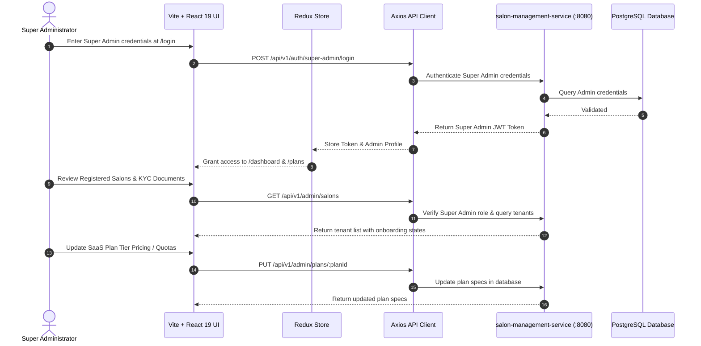

# ZenMonk Super Admin Portal (`salon-admin-app`)

A high-performance management dashboard built for ZenMonk platform super-administrators to monitor platform health, oversee salon tenants, manage subscription plans, and audit salon onboarding and verification workflows.

---

## 1. Problem Statement

A multi-tenant SaaS ecosystem requires centralized administrative oversight:
- **Tenant Lifecycle Governance:** Platform administrators need clear visibility into registered salons, onboarding statuses, verification approvals, and active/inactive salon states.
- **SaaS Pricing & Plan Management:** Administrators must define, update, and manage tier offerings (Starter, Pro, Enterprise) and features available to salon owners.
- **Platform Analytics & Health:** Need a centralized portal to review global statistics including total salons, active bookings, user distribution, and billing statuses across all tenants.

**`salon-admin-app`** solves these challenges by providing platform operators with a secure, dedicated dashboard for tenant management, subscription tier configuration, and system-wide visibility.

---

## 2. High-Level Functional Architecture & Request Flow



---

## 3. Tech Stack

- **Framework:** React 19 + Vite
- **Language:** TypeScript
- **State Management:** Redux Toolkit (`@reduxjs/toolkit`, `react-redux`)
- **Styling:** Tailwind CSS + Class Variance Authority (`cva`)
- **Forms & Validation:** React Hook Form + Resolvers
- **Linter & Tooling:** Oxlint, TypeScript Compiler
- **Icons & UI:** Lucide React, Inter Variable Font

---

## 4. Setup & Running the Application

### Prerequisites
- Node.js (>= 18.x) and npm (for local runs)
- Docker & Docker Compose (for Docker runs)
- Backend service `salon-management-service` accessible on `http://localhost:8080`
- Seeded Super Admin credentials (from backend `npm run seed`)
- Shared Docker network created (for Docker setups):
  ```bash
  docker network create salon_management_shared_network 2>/dev/null || true
  ```

### Environment Configuration
Create or update your `.env` file:
```bash
cp .env.example .env
```
Key configuration parameters:
```env
PORT=3003
APP_FORWARD_PORT=3003
VITE_BACKEND_URL=http://localhost:8080
VITE_STOREFRONT_DOMAIN=salon.com
VITE_STOREFRONT_URL=http://localhost:3001
VITE_APP_NAME=Veloura
```

---

### Running with Docker

#### A. Development Mode (via Docker Compose)
The repository includes a `Dockerfile.dev` and `docker-compose.yml` for rapid local containerized development:

```bash
# 1. Start the container in the background
docker compose up -d --build

# 2. Run the Vite development server inside the running container
docker compose exec app npm run dev -- --host 0.0.0.0 --port 3003

# 3. View container logs
docker compose logs -f app

# 4. Stop container
docker compose down
```

#### B. Production Mode (Multi-Stage Nginx Build)
The production `Dockerfile` builds production assets into static files and serves them via Nginx:

```bash
# 1. Build the production image
docker build -t salon-admin-app:prod .

# 2. Run the production container on port 3003
docker run -d \
  --name salon-admin-app-prod \
  --network salon_management_shared_network \
  -p 3003:80 \
  salon-admin-app:prod

# 3. View Nginx logs
docker logs -f salon-admin-app-prod

# 4. Stop and remove container
docker stop salon-admin-app-prod && docker rm salon-admin-app-prod
```

---

### Running Locally on Host Machine

#### A. Development Mode
```bash
# Install dependencies
npm install

# Run Oxlint validation
npm run lint

# Start Vite dev server on port 3003
npm run dev
```
Open `http://localhost:3003` in your browser.

#### B. Production Build & Preview
```bash
# Build optimized production bundle into /dist
npm run build

# Preview build locally
npm run preview -- --port 3003
```
